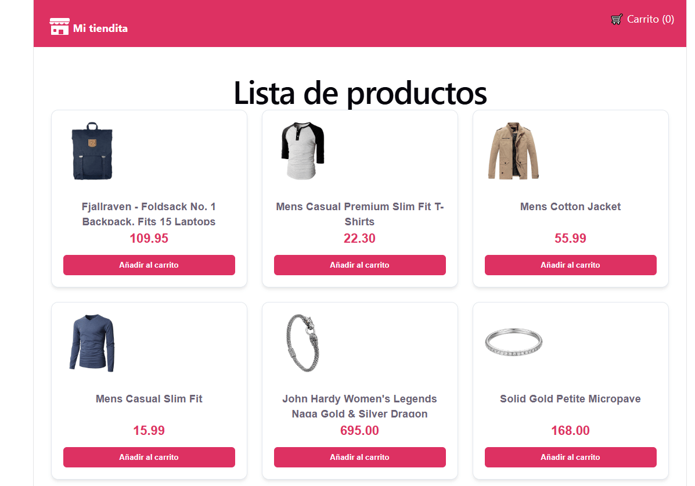
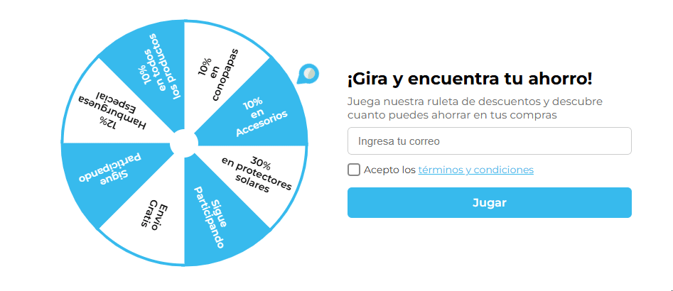

# 💻 React & TypeScript: Advanced Applications Portfolio


Welcome to my development lab! This repository is a **monorepo** that brings together my advanced frontend projects. Its goal is to showcase scalable architecture, complex state management, strict typing, automated testing, and good practices within the modern **React** and **TypeScript** ecosystem.

---

## 🎯 What You'll Find Here

Each folder is an independent application that solves real-world problems (performance, async flows, UI/UX, data persistence).

All projects use **Vite**, strict linting, and are deployed on **Vercel**.

---

## 📂 Project Index

| Project                   | Key Description                                                                                                                                                                                                     | Main Stack                                                                         | Links                                                                                     |
| :------------------------ | :------------------------------------------------------------------------------------------------------------------------------------------------------------------------------------------------------------------ | :--------------------------------------------------------------------------------- | :---------------------------------------------------------------------------------------- |
| **🛍️ Premium E-Commerce** | Online store with a dynamic catalog, a cart persisted in localStorage, and a simulated checkout flow with form validation.                                                                                          | `React` `TypeScript` `Zustand` `React Hook Form` `Zod` `Sass Modules`              | [📁 Code](./ecommerce-premium) · [🔗 Live Demo](https://sallygongar-ecommerce.vercel.app) |
| **🎰 Prize Wheel**        | Gamification wheel for digital marketing, adaptable to any e-commerce store. Dynamic prizes, probability control, and results persisted in the browser **and in Supabase** (an email can only play once per event). | `React` `TypeScript` `HTML5 Canvas` `Sass` `Supabase` `Vercel Serverless` `Vitest` | [📁 Code](./ruleta) · [🔗 Live Demo](https://ruleta-sagongar.vercel.app/)                 |

> ℹ️ The prize wheel uses a free Supabase project. A scheduled GitHub Action calls the API once a day so the database is not paused for inactivity.

### 🎬 Previews

**🛍️ Premium E-Commerce**



**🎰 Prize Wheel**



---

## 🛠️ Technical Skills Demonstrated

**Frontend**

- **Advanced TypeScript:** interfaces with `extends`, generic types, strictly typed events and API responses.
- **State management:** `Zustand` in the e-commerce app and React Context in the wheel, choosing the tool that fits each case.
- **React patterns:** Custom Hooks to isolate business logic and effects from presentational components, and effects that ignore stale async responses.
- **Forms and validation:** schema-based validation with `Zod` and `React Hook Form`.
- **Animation and graphics:** parametric rendering with HTML5 Canvas and GPU-accelerated CSS animations.
- **Modular styling:** `Sass Modules` to avoid global CSS collisions.
- **Resilient UI:** loading and error states, including an accessible error alert with a retry button.

**Lightweight fullstack**

- **Serverless functions** (Vercel) written in TypeScript with ESM.
- **Supabase** as the database, with server-side verification before every play.
- **Dual persistence:** `localStorage` for instant UX and Supabase as the source of truth.
- **API hardening:** generic messages on server errors, with the details kept in the logs.

**Testing and tooling**

- **Unit and component tests** with `Vitest` and `Testing Library` in the prize wheel: pure functions, services with a mocked `fetch`, components, and the context provider with fake timers.
- **CI with GitHub Actions:** lint, tests and build on every pull request that touches the prize wheel.
- **Scheduled workflow** that keeps the Supabase project active.
- **Conventional commits** and pull requests with a description and a test plan.

---

## 🗺️ Roadmap

- [x] Tests with Vitest and Testing Library for the prize wheel
- [x] GitHub Actions for the prize wheel (lint, tests and build)
- [ ] Tests and CI for the e-commerce app (cart and checkout validation)
- [ ] Server-side prize selection (prize wheel)
- [ ] Dashboard with authentication, roles, tables, and charts
- [ ] Next.js app (SSR/SSG)
- [ ] Accessible component library with Storybook
- [ ] Personal portfolio website

---

## ⚙️ Monorepo Structure

```text
react-advanced-apps/
├── .github/workflows/   # CI for the prize wheel and Supabase keep-alive
├── ecommerce-premium/   # App 1: store and simulated checkout
├── ruleta/              # App 2: prize wheel with Supabase
└── README.md            # Main navigation guide
```

Each app is independent: go into its folder, install dependencies, and run `npm run dev`. The prize wheel needs environment variables and `vercel dev` to run its API locally. See each app's README for details.

---

## 📬 Let's Talk!

If you are a recruiter, a developer, or just interested in my work:

- **GitHub:** [@sallygongar](https://github.com/sallygongar)
- **LinkedIn:** [Sally González](https://www.linkedin.com/in/sally-candelaria-b56a9a183/)
- **Email:** sallygonzalez1908@gmail.com
