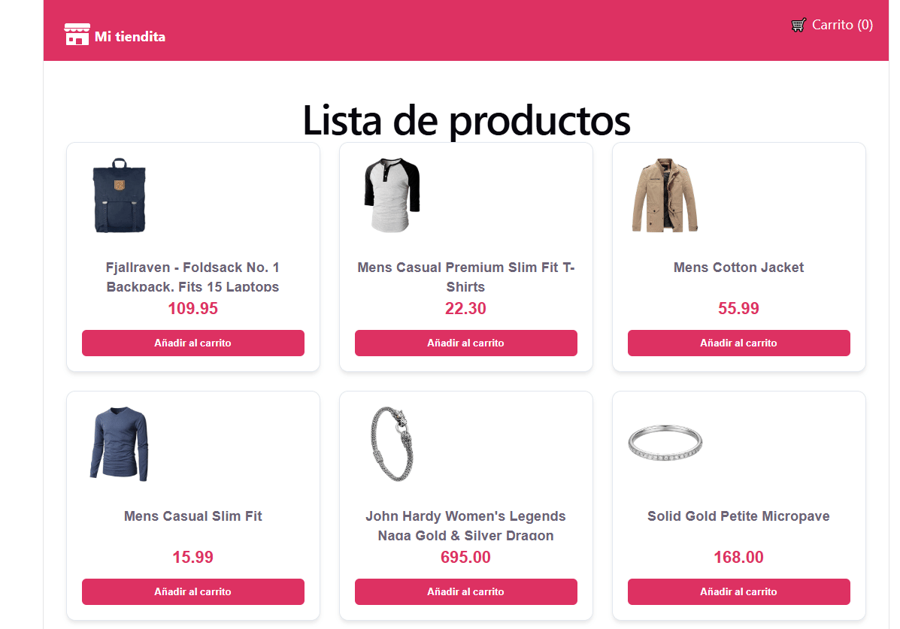

# 🛍️ TS/React E-Commerce with a Simulated Payment Gateway

A modern, fast and fully typed e-commerce app built with **React 19**, **TypeScript** and **Vite**.

> **Live demo:** [sallygongar-ecommerce.vercel.app](https://sallygongar-ecommerce.vercel.app/)

**🛍️ Demo E-Commerce**



The app consumes the public products API **TODO: API name and link**, keeps a persistent shopping cart, and includes a checkout flow with card validation. The payment is a **simulation**: no real card data is processed or stored.

Built with separation of concerns through Custom Hooks and modular styles.

---

## 🛠️ Tech Stack

- **Core:** [React 19](https://react.dev/) + [Vite](https://vitejs.dev/).
- **Language:** [TypeScript](https://www.typescriptlang.org/) with strict typing.
- **Global state:** [Zustand](https://zustand-demo.pmnd.rs/) with persistence middleware for the cart.
- **Routing:** [React Router](https://reactrouter.com/) (SPA).
- **Forms and validation:** [React Hook Form](https://react-hook-form.com/) + [Zod](https://zod.dev/).
- **Styling:** [Sass Modules](https://sass-lang.com/), with component-scoped styles.
- **Quality:** ESLint with `typescript-eslint` and the React Hooks rules.

---

## 💡 Key Features

1. **Isolated async logic:** API calls, loading state (`loading`) and error state (`error`) live in the `useProducts` Custom Hook, separated from the UI.
2. **Optimized global state:** the cart is read with Zustand selectors, so each component only re-renders when the data it uses changes.
3. **Automatic persistence:** the cart survives page reloads and closed tabs thanks to the `persist` middleware, which syncs with `localStorage`.
4. **Checkout with validation:** the form validates the card format with Zod (16 digits, MM/YY and CVV) and simulates network latency before confirming the purchase.

---

## 📁 Project Structure

```text
src/
├── components/      # Reusable UI components (Navbar, etc.)
├── hooks/           # Isolated async logic (useProducts)
├── pages/           # Main views (Home, Cart, Checkout, Success)
├── store/           # Global state with Zustand (useCartStore)
├── styles/          # Global Sass variables and base styles
└── types/           # TypeScript interfaces and types
```

---

## 🚀 Getting Started

Requires **Node.js 20 or higher** (22 recommended).

```bash
# 1. Clone the repository (it is a monorepo)
git clone https://github.com/sallygongar/react-advanced-apps.git
cd react-advanced-apps/ecommerce-premium

# 2. Install dependencies
npm install

# 3. Start the development server
npm run dev
```

### Available scripts

| Command           | What it does                                                  |
| :---------------- | :------------------------------------------------------------ |
| `npm run dev`     | Starts the Vite development server                            |
| `npm run build`   | Type-checks (`tsc -b`) and builds for production into `dist/` |
| `npm run preview` | Serves the production build locally                           |
| `npm run lint`    | Runs ESLint on the project                                    |

---

## 🗺️ Next Steps

- [ ] Tests with Vitest and Testing Library (cart and checkout validation schema)
- [ ] Product detail page
- [ ] Search and category filters in the catalog
- [ ] Card number validation with the Luhn algorithm

---

## 📄 License

Distributed under the MIT License.
